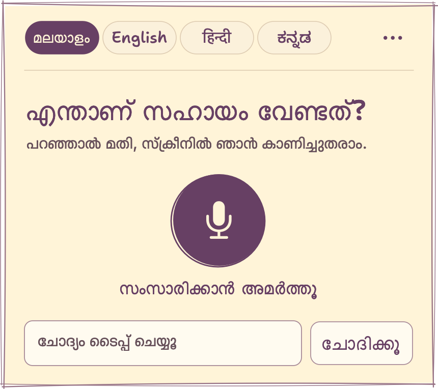
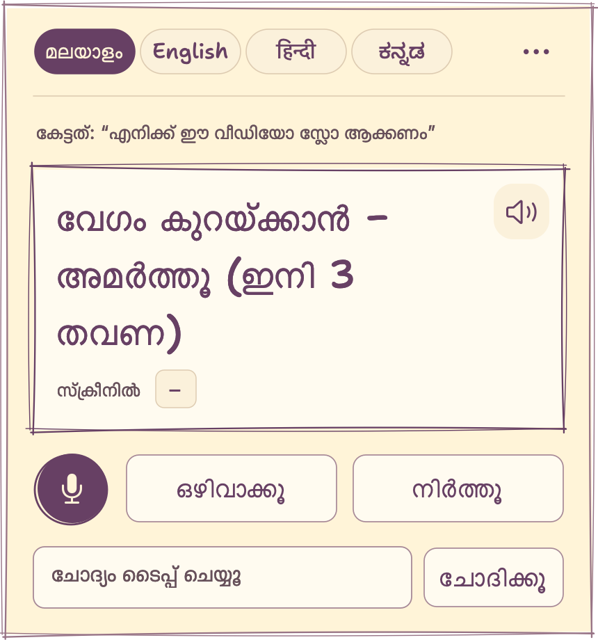
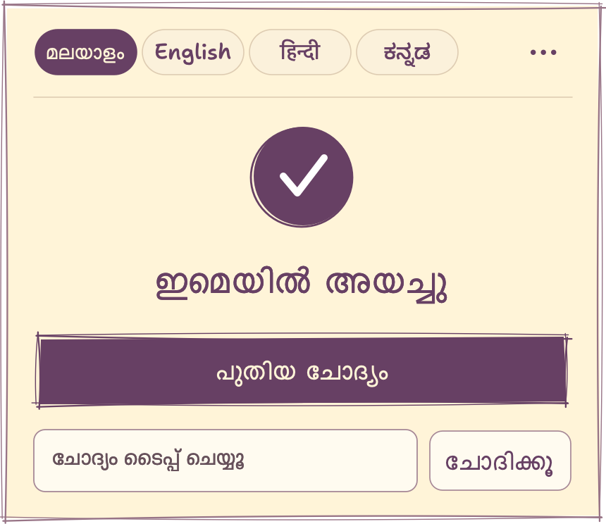
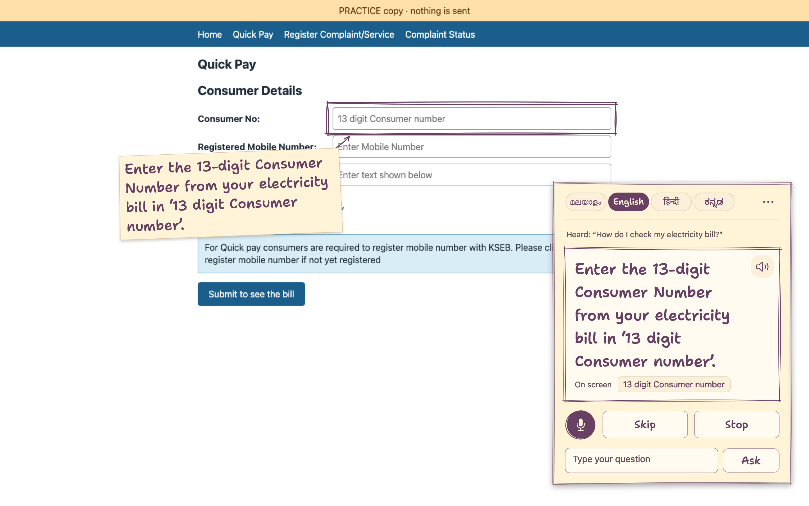

# HackaThoni Companion

> 🥈 **2nd place at HackaThoni 2026** (Alappuzha, 21–22 November 2026) · Track 02: Voice & Language, "Beyond English"

**A voice companion that teaches people who struggle with computers where to click, in their own language.**
Ask in Malayalam. A hand-drawn arrow points at the next button and the companion speaks the step aloud. You make every click yourself, so next time you can do it alone. It never clicks for you.

## ▶️ Demo video

[](https://www.youtube.com/watch?v=YsxJdO9J-Xs)

**[Watch the demo on YouTube](https://www.youtube.com/watch?v=YsxJdO9J-Xs)**: GasUndo, YouTube and Gmail, guided by voice in Malayalam.

## Who it's for

Parents and grandparents, and anyone who can read a letter but doesn't know that "Compose" means "write one". In Kerala, only about half of adults can send an email (MoSPI CMS 2025). The websites people need are in English, so they wait for someone to come home and click for them. The companion teaches them instead.


*Preview: the app's panel and arrow drawn onto a page capture. Ask "Is Bektash Kakkanad open?" and it points to **Search restaurants** on GasUndo.*

## How it works

1. **Ask by voice** in Malayalam or English. Sarvam Saaras turns speech into text.
2. **It reads the page.** macOS Accessibility exposes the controls on the current Safari page, with no screenshots and no typed values.
3. **It points and speaks.** A hand-drawn arrow marks the next control, and Sarvam Bulbul speaks the step in your language.
4. **You click.** The companion sees what changed and moves to the next step.

## What it can do today

| Site | Try saying | What happens |
|---|---|---|
| **GasUndo** (built by HackaThoni organisers Vaishakh Suresh and Viswanatha Kartha V) | "Bektash Kakkanad thurannittundo?" / "Is Bektash Kakkanad open?" | District → Search restaurants → the restaurant → reads the report aloud, and says honestly when the report is old |
| **YouTube** | "Darshana paattu play cheyyoo", then "Enikku ee video slow aakkanam" | Search → the official video (it handles ads and Skip) → Settings → Playback speed → "−" with a countdown to 0.75× |
| **Gmail** | "Ente makanu oru email ayakkanam" / "I want to write a mail" | Compose → To → Subject → Message → Send → "Your email was sent" |
| **KSEB Quick Pay** (practice copy) | "How do I pay my electricity bill?" | Walks the form up to the captcha, and never pays |

YouTube also handles faster, pause and play, mute, Malayalam subtitles and full screen.

**Languages.** Malayalam and English have been tested live. Hindi and Kannada are implemented and covered by offline tests; live verification is pending.

**Privacy.** The reader skips passwords and typed values and reduces URLs to the site name. In Gmail it sees only interface labels such as **Compose**, **To** and **Send**, never your subjects, recipients or messages.

## See the companion

| Ready | Guiding (YouTube speed) | Done (Gmail) |
|---|---|---|
|  |  |  |

English versions: [guiding](docs/screenshots/guiding-en.png) · [done](docs/screenshots/done-en.png) · [language picker](docs/screenshots/language-picker.png)



*Preview: the app's panel and arrow drawn onto a page capture.*

## How we use Sarvam AI

Sarvam is the voice and language layer, called live while the companion runs:

- **Saaras v4 (speech to text).** It transcribes the question in Malayalam or English and also translates Malayalam speech to English for the planner. With the panel set to English it auto-detects Malayalam. The button names on screen are sent as key terms, so words like "Compose" and "Search" are heard correctly.
- **Bulbul v3 (text to speech).** It speaks every step back in the chosen language.
- **Sarvam LLM (`sarvam-105b-conversations`).** It works out what you meant when a request isn't one of the phrases the companion already knows: one structured-JSON call, limited to a fixed list of actions. Known tasks need no LLM call. Each site's steps come from our own code, so the model never invents a button.
- **Sarvam Translate and Transliterate.** Translate turns each step into Hindi or Kannada and keeps on-screen labels such as ‘Search’ in English. Transliterate turns a restaurant name spoken in Malayalam script into Latin letters, so it can be typed into GasUndo's search box.

## How we use Devin

Devin repairs bugs found by our own QA, with a human reviewing and merging the fix:

1. QA's replay found a real bug: on a YouTube player, "make it faster" wasn't understood (commit `329cc68`).
2. [`tools/devin_case`](tools/devin_case) turns the bug into a case: the exact repro, the expected and actual result, and the commit. After a developer approves that case, it starts a Devin session through the Devin API, capped at 5 ACUs.
3. Devin opened [PR #4](https://github.com/arice77/hackathoni-companion/pull/4) with the fix and a regression test.
4. The same replay ran on Devin's exact commit `136ba45`. It passed: the arrow lands on Settings with no fallback call. The developer then reviewed and merged it. Record: [docs/devin-cases](docs/devin-cases).

The rest of the companion was built with AI coding agents (Claude and Codex) orchestrated in Conductor. Devin's role is this verified repair loop.

## Quick start (macOS)

You need `uv` installed and a Sarvam API key. Put `SARVAM_API_KEY=…` in a git-ignored `.env` at the repo root, open a supported page in Safari, and grant Accessibility access to your terminal. Allow microphone access when prompted.

```sh
./scripts/bootstrap.sh
.venv/bin/python -m companion.app --task web_site --lang ml   # --lang ml | en | hi | kn
.venv/bin/python scripts/qa/run.py                             # offline QA suite
```

## Project layout

| Path | What's there |
|---|---|
| `companion/app.py` | The app: panel, mic, overlay, planning loop |
| `companion/reader.py` | macOS Accessibility page reader, with the privacy gates |
| `companion/sites/` | Site guides: GasUndo, YouTube, Gmail, KSEB |
| `companion/planner_sarvam.py` | Sarvam LLM planner and intent fallback |
| `companion/voice/` | Sarvam Saaras, Bulbul, Translate and Transliterate, plus the mic |
| `companion/overlay/`, `companion/panel/` | Hand-drawn arrow and the "paper note" panel |
| `scripts/qa/` | QA harness: offline replays plus live follow-the-pointer checks |
| `tools/devin_case/` | Devin repair-case tool |
| `docs/` | [Build board](docs/build-board.md), [pitch script](docs/pitch-script.md), site notes, screenshots |

## What's next

- Android, where most parents actually use the internet.
- More everyday Indian sites, such as Aadhaar updates and bill payments, and guided practice for students learning computers.
- More Indian languages through Sarvam.
- Reviewing the Malayalam wording with native speakers, and testing with real families.

---

Built overnight on a houseboat in Alappuzha for HackaThoni 2026 by Abin Saji.
