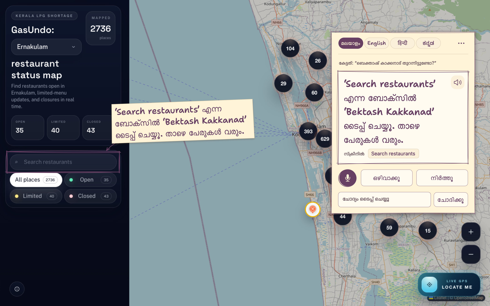

# HackaThoni Companion



*Preview: the app's panel and arrow drawn onto a page capture.*

Ask in Malayalam, “Is Bektash Kakkanad open?” The companion points to **Search restaurants** on GasUndo and tells you what to type. It teaches people who are getting comfortable with computers where to click. You make every click yourself, so next time you know where to go.

## How it works

1. Ask by voice. Sarvam Saaras transcribes your question.
2. The Mac reads the controls on the current Safari page through macOS Accessibility.
3. A hand-drawn arrow points to the next control. Sarvam Bulbul speaks the step in your language.
4. You click. The companion checks what changed and points out the next step.

**Sites.** Check a restaurant report on GasUndo, find a song or slow down playback on YouTube, compose and send an email in Gmail, or practise finding your electricity bill on the KSEB Quick Pay practice copy.

**Languages.** Malayalam and English have been tested live. Hindi and Kannada are implemented and covered by offline tests. Live verification for those two languages is pending. [View the language picker](docs/screenshots/language-picker.png)

**Privacy.** The page reader skips passwords and typed values. In Gmail it uses interface labels such as **Compose**, **To** and **Send**, and the **Message sent** confirmation. Your email subjects, recipients and message bodies stay out of the page data sent to the planner.

## Quick start on macOS

From the repo root, with `uv` installed and `SARVAM_API_KEY` set in your environment, run the following. Open a supported page in Safari and grant Accessibility access to the launching terminal. Allow microphone access when prompted for voice input.

```sh
./scripts/bootstrap.sh
.venv/bin/python -m companion.app --task web_site --lang ml
```

## See the companion

| Panel state | Malayalam | English |
| --- | --- | --- |
| Ready for a question | [Tap to speak](docs/screenshots/idle-ml.png) | |
| Guiding on YouTube | [വേഗം കുറയ്ക്കാൻ](docs/screenshots/guiding-ml.png) | [Press − three more times](docs/screenshots/guiding-en.png) |
| Gmail confirms Send | [ഇമെയിൽ അയച്ചു](docs/screenshots/done-ml.png) | [Your email was sent](docs/screenshots/done-en.png) |


*Preview: the app's panel and arrow drawn onto a page capture.*

## Original hackathon handoff

These early planning notes record the prototype stage. The [build board](docs/build-board.md) tracks subsequent work.

Local handoff for the overnight Alappuzha hackathon. Start with [the local research](outputs/alappuzha-problem-research-2026-11-21.md) and [the companion build notes](<building companion app.md>).

- The crop-loss application coach is the leading hypothesis. Pick the demo after checking where the real workflow stalls. The wage diary, houseboat receipt workflow, and ferry timetable are alternatives.
- The native component baseline passed Accessibility reading, live pointer alignment, and manual click-through on a controlled fixture. Utter dictation, Sarvam calls, and the complete application are pending.
- The selected sketch style is Plum `#674064`, roughness `1.9`, and playfulness `35`. The recorded [style settings](work/companion-style-preview/selected-style.json) and [verified visual preview](work/companion-style-preview/preview-selected.png) apply to the simulated screens.

The web style preview is self-contained. From the repository root, run:

```sh
python3 -m http.server "${CONDUCTOR_PORT:-8000}" --bind 127.0.0.1 --directory work/companion-style-preview
```

The native fixture sources and test evidence are in [work/companion-components](work/companion-components/README.md). To repeat the native test on this Mac, use the already registered fixture in the original workspace documented in the build notes. Its macOS permission was previously tied to the exact signed build. For a fresh environment, treat the existing probe as reference code that expects the pinned H Companion checkout, its own Python virtual environment, and a locally built test bundle.

In Conductor, choose the local project and start one coordinator chat using [HANDOFF.md](HANDOFF.md). The initial Git commit carries the selected notes, test evidence, fixture sources, and preview assets into any new worktree. Archived notes still link to some files in the original local workspace. The Git project starts without a remote.
