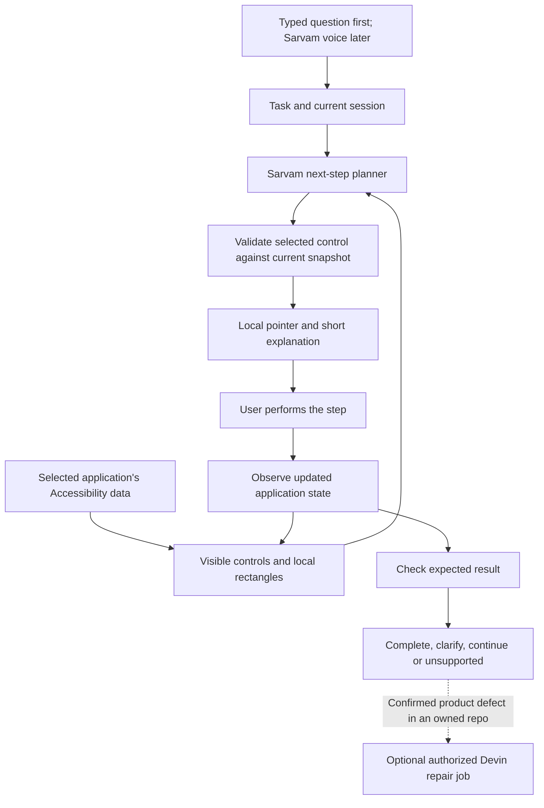

# High-level plan: H Companion with Sarvam and Devin

Date: 21 November 2026. Status: proposed plan, not an implementation approval. No installation, application launch, model call or application-code change is part of this planning step.

## Product and constraints

Build a macOS companion that helps a person complete a task in their current application. They ask a question, receive a short explanation and see a pointer over the relevant control. They perform the clicks; the companion observes the new state and offers the next instruction.

H Company signup is unavailable according to the user's attempted signup. The proposed active path therefore must work without an H account, H login or H inference. Sarvam is the proposed language and voice provider. Devin can help implement and test the project; an in-product repair workflow is a separate later milestone.

The first version should support one chosen application and a few representative tasks. Cross-application coverage is a longer-term product direction, not an initial guarantee. The target application and its first tasks remain to be chosen.

## What the code study established

The inspected H Companion revision is `287c4c1bd64f58869fc52db17aaa63f62744dbcb`. Its core components already exist:

| Component | Actual implementation | Implication |
|---|---|---|
| Desktop UI | `desktop/` Electron window, tray, activity and voice controls | Keep this as the initial user interface. The separate `app/` contains another experimental interface; do not accidentally migrate both. |
| Screen observer | macOS Accessibility reader supplies control roles, labels and rectangles | Structured screen information is already available without asking a vision model to invent coordinates. |
| Next-step planner | `Grounder.plan_step` sends text describing the page, candidate controls, task and history to Holo | This is the first replacement to investigate. It is different from screenshot-based pointing. |
| Pointer and guidance loop | Local overlay, instruction playback and observation of user interaction | Preserve these behaviors while changing the planner provider. |
| Verification | Broader paths have Holo visual checks; native Devin coaching disables screenshot verification | We need an explicit completion strategy for the first supported tasks. A click or model declaration is insufficient. |
| Product repair | Separate support backend can start a Devin session for an allowed repository | This does not automatically merge, deploy and replay a repaired application. |

The current Finder launcher is a specific read-only Devin Desktop coaching preset, with automatic repair disabled. It is not a neutral launcher for every application. H authentication is also constructed inside `HBackend` and `Grounder`, so replacing a URL or API key alone is insufficient. [Detailed code study](h-companion-code-study.md)

## Proposed architecture

Sarvam-105B receives structured text and returns a next-step decision. Our local code owns screen rectangles, pointer placement, permitted actions and completion state. Its output should identify an existing control, not invent screen coordinates. Sarvam documents text input and structured JSON output; whether it chooses the correct controls reliably is still an experimental question. [Model capabilities](https://docs.sarvam.ai/api/getting-started/models) · [Structured outputs](https://docs.sarvam.ai/api/token-factory/chat-completions)

## Milestone 1: prove the planner replacement

Before integrating the whole application, define a small set of sanitized screen-control snapshots from the chosen app, paired with user requests and expected next controls. Include opening a menu, selecting between similar controls, a missing target and a changed page. Start with typed input so speech recognition cannot hide a planning error.

Specify a provider-neutral planner contract that can express a valid target, a clarification, an unsupported state or a proposed completion. Bind each selection to a snapshot revision and validate it locally. Keep the exact on-screen control label even when the explanation uses another language.

**Exit condition:** measure selection correctness, invalid selections and response time on the agreed cases. Reject unknown targets and stale snapshots. If results are inadequate, revise the approach before investing in voice, automation or visual polish. This milestone is not yet performed.

## Milestone 2: one complete guidance flow without H Company

Add a guidance-only backend whose planner is supplied by Sarvam. Retain the useful Accessibility observer, overlay and session UX. Do not leave the active path dependent on H client construction, H quota requests, H screenshot fallback or H-based verification. Keep unsupported autonomous operations disabled rather than silently falling through to H.

Use a dedicated launcher for the selected app, with guidance-only behavior and a clear Stop control. Re-observe after every user step. If the user switches applications, opens a dialog, scrolls or moves a window, refresh the snapshot before drawing another pointer. When observation is incomplete, ask for clarification or report the limitation.

For the first tasks, define positive completion evidence: a saved record, a visible status change or a specific field value. If the evidence is unavailable, distinguish user-confirmed completion from independently observed completion.

**Exit condition:** the user can finish the selected tasks from different starting states, the pointer follows the correct visible control and a failed task is not presented as complete. This milestone establishes the product's central value.

## Milestone 3: add Sarvam voice

Introduce separate speech-input and speech-output adapters. Saaras replaces Gladia transcription; Bulbul replaces the external narration provider. Preserve push-to-talk behavior, the transcript display, cancellation, audio cleanup, interruption and alignment between the pointer and the spoken instruction. The Mac's local voice or text output can remain a fallback.

Begin with English and Malayalam-English mixed speech, subject to the user's language preference. Test real microphone recordings containing English UI labels, short clips and noisy audio. Never replace failed transcription with the intended test question. Keep the first spoken instruction short and put long diagnostics or repair work outside the response path.

**Exit condition:** the question actually received by the planner is visible, empty transcription produces a useful retry path, TTS failure leaves readable guidance, and Stop reliably halts the current interaction. Measure microphone release to the first useful response separately from total task duration.

Useful precedents: SADAK runs secondary analysis outside the spoken response; Quotra's real-microphone tests exposed failures that synthetic speech tests missed. [Sarvam source study](sarvam-winning-code-study.md)

## Milestone 4: add a concrete Devin contribution

Use Devin for implementation and meaningful integration checks, retaining reviewable changes and results. That does not require adding a repair button to the first user experience.

If we later add in-product repairs, restrict them to a connected repository we control. Distinguish an actual product defect from a missing Accessibility control, an incorrect model suggestion or a permission problem. Prepare a case with reproduction steps and expected versus observed state; submit it on the user's explicit request. Track the returned session and PR separately from guidance. Review the proposed change and rerun the original failing task before claiming a repair succeeded.

**Exit condition:** one reproducible issue produces a traceable Devin job and a reviewed change whose outcome can be demonstrated. Player Two's documented repair took several minutes, so do not make immediate voice guidance wait for that workflow. [Devin source study](devin-winning-code-study.md)

## Scope and safety boundaries

- Initial scope: macOS, one supported application, a few tasks, human clicks and Accessibility-based observation.
- Defer arbitrary screenshot-only interfaces, automatic clicking, gaze tracking, payments, background screen monitoring and automatic PR merging.
- If the chosen app does not expose useful Accessibility data, stop that path and evaluate a narrower app or a separately tested image-capable model. Sarvam's platform lists hosted image-capable models, but that alone does not establish reliable pointing accuracy.
- Keep credentials in local private configuration and out of the renderer. Share only the selected app's necessary control data with the model; retain a bounded, redacted task history.
- Avoid the optional unauthenticated bare HTTP server identified by the security review. Any endpoints introduced for this version need authenticated local access and contained report paths.
- The existing mock CLI can still start input listeners, and its usage endpoint can make service requests. Define a genuinely isolated preview path rather than assuming `--mock` eliminates every permission or network side effect.
- Review the minimal dependency set before installation. The supply-chain inspection found public registry sources and integrity hashes, but that is not a complete malware or vulnerability assessment. Avoid installing unused desktop drivers and experimental UI dependencies merely because they exist in the original repo.

[Partial security assessment](/Users/abinsaji/Documents/Codex/2026-11-08/https-www-hackathoni-in-https-www/outputs/h-companion-security-review-2026-11-21.md)

## Setup implied by this plan

The proposed guidance and voice path needs a Sarvam API account. It should not need H Company, Gladia or ElevenLabs accounts. Devin product API credentials and repository access are only needed if the runtime repair milestone is included. Local macOS observation and audio permissions are requested only when we reach the corresponding live validation stage.

## Decisions to settle before implementation

1. Which first application and two or three tasks best demonstrate the user's problem?
2. Is the first release guidance-only, as recommended here, or must it also act automatically?
3. Which spoken languages should be supported first?
4. Is Devin's product repair workflow part of the hackathon demo, or is its initial role building and testing the companion?

The recommended first engineering deliverable is a typed question selecting and highlighting the correct live control in one app, with no H credentials. Voice and repair follow only after that capability is demonstrated.
